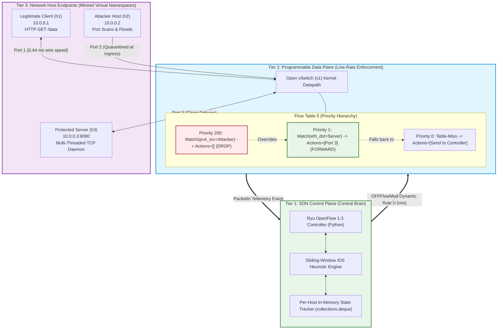
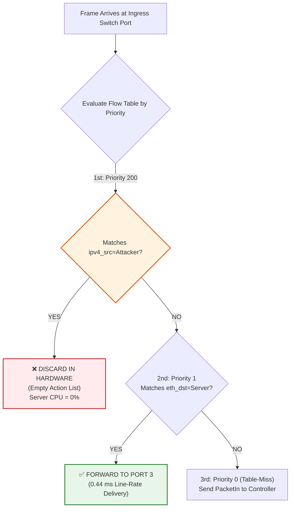

# System Architecture & OpenFlow 1.3 Control Plane

AegisFlow structures network security around a clean **3-Tier Master Hierarchy**, enforcing a strict separation between global intelligence and high-speed packet forwarding.

---

## The 3-Tier Master Architecture



---

## 1. Tier 1: The SDN Control Plane (The Brain)

* **Technology:** Ryu SDN Framework (Python 3, OpenFlow 1.3 protocol).
* **Role:** Operates on port `6633`. It maintains global visibility over every connected Open vSwitch datapath, learns MAC-to-port topologies, processes incoming `PacketIn` notifications, and executes algorithmic threat detection.
* **Key Design Choice:** The controller does **not** process routine packet payloads. It only handles the first packet of a new flow (`Table-Miss`) or packets explicitly flagged for inspection. Once it makes a policy decision, it delegates the work entirely to the switch.

---

## 2. Tier 2: The Programmable Data Plane (The Muscles)

* **Technology:** Open vSwitch (OVS `s1`) executing in kernel space.
* **Role:** High-speed line-rate frame switching using flow tables stored in TCAM (Ternary Content-Addressable Memory) and kernel flow caches.
* **Key Characteristic:** Open vSwitch has **no independent thinking**. It matches packet headers against its Flow Table at microsecond speeds. If a flow entry exists, it acts immediately; if not, it queries Tier 1.

---

## 3. Tier 3: Network Host Endpoints (Mininet)

* **Host `h1` (`10.0.0.1`):** The legitimate user running `client.py`, requesting web data at paced intervals and logging Round-Trip Time (RTT).
* **Host `h2` (`10.0.0.2`):** The adversary running `attacker.py`, executing vertical port scans, volumetric bursts, SYN floods, subnet sweeps, or Slowloris attacks.
* **Host `h3` (`10.0.0.3:8080`):** The victim target server running `server.py`, a multi-threaded POSIX socket daemon with an OS kernel listen backlog queue of 100 connections.

---

## OpenFlow 1.3 Message Flow & Protocol Mechanics

The communication between the Ryu Controller and Open vSwitch relies on three standardized OpenFlow 1.3 messages:

### Message 1: The Table-Miss Default Rule (`Priority 0`)
When Open vSwitch boots, the controller installs a wildcard rule at the bottom of Flow Table 0:
```python
match = parser.OFPMatch()  # Match all packets
actions = [parser.OFPActionOutput(ofproto.OFPP_CONTROLLER, ofproto.OFPCML_NO_BUFFER)]
self.add_flow(datapath, priority=0, match=match, actions=actions)
```
* **Purpose:** If a packet arrives and matches no other rule, the switch wraps the packet headers into an OpenFlow `PacketIn` message and sends it to the controller.

### Message 2: `PacketIn` Telemetry Ingestion
When an unfamiliar packet arrives at the switch (e.g., an attacker probing port 22 or port 80):
1. The switch matches Priority 0.
2. The switch dispatches an `EventOFPPacketIn` to Ryu.
3. Ryu parses the packet onion:
   $$\text{Ethernet Header} \longrightarrow \text{IPv4 Header} \longrightarrow \text{TCP Header}$$
4. Ryu extracts `ipv4_src`, `ipv4_dst`, `dst_port`, `tcp_flags`, and monotonic arrival timestamp.

### Message 3: `OFPFlowMod` Dynamic Defense Rule Injection
When an anomaly threshold is breached, Ryu constructs an `OFPFlowMod` message:
```python
match = parser.OFPMatch(
    eth_type=0x0800,       # IPv4
    ip_proto=6,            # TCP
    ipv4_src=attacker_ip   # Attacker IP
)
actions = []  # Empty action list = HARDWARE DROP!
self.add_flow(datapath, priority=200, match=match, actions=actions, hard_timeout=60)
```
* **Speed:** Pushed over the local control channel in **$< 1.0\text{ ms}$**.

---

## The Priority Hierarchy Principle ($200 > 1 > 0$)

OpenFlow switches evaluate table rules strictly in **descending numerical order of priority**:



1. **Priority 200 (Active Threat Quarantine):** Matches the attacker's source IP with an **empty action list**. Because $200 > 1$, this rule preempts normal forwarding without requiring existing routing rules to be modified or deleted.
2. **Priority 1 (L2 Normal Forwarding):** Directs legitimate client traffic straight to the server host port.
3. **Priority 0 (Table-Miss):** Forwards unknown frames to the controller for inspection.

---

## The Penalty Box Lifecycle (`hard_timeout = 60s`)

Hardware switch tables (TCAM) have finite memory. If blacklisted IP rules remained indefinitely, switch memory would exhaust over time.

AegisFlow assigns `hard_timeout = 60` to every Priority 200 rule:
* The switch automatically purges the rule exactly 60 seconds after installation.
* If the attacker resumes malicious probing, the controller detects it and reinstates the penalty box in $<120\text{ ms}$.
* If the attacker has stopped, the switch TCAM slot is freed with zero manual cleanup required.
