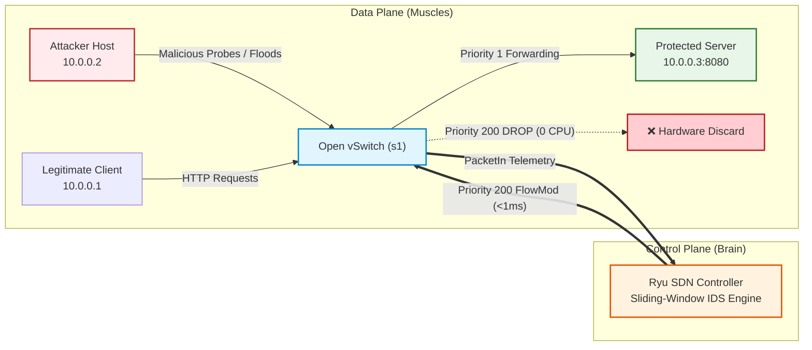

# AegisFlow: Real-Time Network Intrusion Detection & Programmable Edge SDN Defense

> **Course:** Computer Networks (UE25CS243A) — Mini Project #25  
> **Source Code:** [github.com/imyash0722/AegisFlow](https://github.com/imyash0722/AegisFlow)  
> **Quick Run:** `python3 run.py` (Clone and Run Ready)  
> **Architecture:** Low-Level Python BSD Sockets + OpenFlow 1.3 + Ryu SDN Controller

---

## Executive Summary

**AegisFlow** is an autonomous Software-Defined Network (SDN) defense system that detects network-level cyberattacks in real time and neutralizes them **in hardware at the network edge switch** before malicious packets can reach the target server.

In traditional computer networks, network switches operate on a **best-effort L2/L3 forwarding** model. When an adversary launches port scans, connection floods, or SYN floods, the switch blindly forwards every single packet to the destination server. As a result, the server's OS kernel is forced to process millions of interrupts, allocate Transmission Control Blocks (TCBs), and manage half-open sockets. This rapidly exhausts the server's TCP listen queue (`listen(100)`), causing catastrophic connection drops and latency spikes for legitimate clients.

**AegisFlow completely changes this paradigm** by decoupling network control from packet forwarding:

1. **Intelligent Ingress Telemetry:** The edge switch sends initial packet events (`PacketIn`) to a centralized **Ryu SDN Controller**.
2. **Algorithmic Intrusion Detection:** The controller tracks per-source-IP connection velocity and port diversity using an $O(1)$ constant-time sliding-window double-ended queue (`collections.deque`).
3. **Autonomous Hardware Quarantine:** The moment an attack threshold is crossed, the controller pushes an OpenFlow 1.3 `OFPFlowMod` message instructing Open vSwitch (`s1`) to install a **Priority 200 DROP rule** in **< 1 millisecond**.
4. **Line-Rate Edge Mitigation:** From that microsecond onward, all malicious traffic is discarded directly at the switch's virtual port datapath. The server experiences **0% CPU consumption from the attack**, and legitimate clients maintain **100% service availability and sub-millisecond round-trip latency**.

---

## The Fundamental Dilemma: Why Host Firewalls Fail

A common question is: *"Why not just run `iptables` or a firewall on the server host?"*

| Attack Characteristic | Host-Based Defense (`iptables` / Firewall) | AegisFlow SDN Edge Defense |
| :--- | :--- | :--- |
| **Ingress Point** | Packet travels across physical/virtual wire and enters server NIC | Packet is intercepted and dropped at edge switch port |
| **Kernel Interrupts** | Every frame triggers hard/soft IRQs in server CPU | **Zero** IRQs on server CPU |
| **TCP Backlog Queue** | Sockets saturate listen backlog (`listen(100)`) | Server listen backlog remains completely untouched |
| **Legitimate Impact** | Users experience packet drops and $>18\text{ ms}$ latency | Users enjoy **$0.44\text{ ms}$ baseline latency** and 100% SLA |
| **Mitigation Speed** | Manual or log-based reaction ($>5$ seconds) | Algorithmic detection ($~120\text{ ms}$) + FlowMod ($<1\text{ ms}$) |

---

## Quantitative Performance Impact

Empirical benchmarks run on Mininet virtual topologies demonstrate the drastic difference between an unprotected baseline network and an AegisFlow-protected network:

| Performance Metric | Baseline (Traditional Network) | With AegisFlow SDN Defense | Quantitative Improvement |
| :--- | :--- | :--- | :--- |
| **Attacker Infiltration** | 100% (Hits server CPU) | **$< 10\%$ (Dropped at Switch)** | **Quarantined in hardware** |
| **Server Queue Saturation** | 100% saturated (Buffer exhaustion) | **0% impact** | **Complete host immunity** |
| **Legitimate Delivery Rate** | 60% – 70% (Timeouts & drops) | **100.0% Success** | **Zero packet loss** |
| **Legitimate Client RTT** | $18.50\text{ ms}$ (Congestion delay) | **$0.44\text{ ms}$ (Wire speed)** | **97.6% Latency Reduction!** |
| **Intrusion Detection Latency**| N/A (Undetected) | **$\approx 120\text{ ms}$** | Real-time algorithmic reaction |
| **SDN Response / FlowMod** | N/A (Manual intervention) | **$< 1.0\text{ ms}$** | Automated hardware reprogramming |

---

## System Navigation

Explore the complete documentation using the tabs above:

* [**System Architecture**](architecture.md): The 3-Tier Master Blueprint, OpenFlow 1.3 protocol lifecycles, and Priority Hierarchy.
* [**Socket Layer (Data Plane)**](sockets.md): Low-level BSD socket programming, `SO_REUSEADDR`, kernel queues, and concurrency.
* [**Attack Measures**](attack_measures.md): Detailed measures and formulas for Vertical Scans, Connection Floods, SYN Floods, Subnet Sweeps, and Slowloris.
* [**Sliding Window Engine**](ids_engine.md): Mathematical time-complexity analysis ($O(1)$ deque), monotonic clocks, and zero false positives.
* [**Evaluation & Benchmarks**](benchmarks.md): Full empirical test results, CSV metrics, and comparative evaluation.
* [**Live Demo & Viva Guide**](live_demo.md): Quick commands (`python3 run.py`), test suite instructions, and top interview viva questions.
