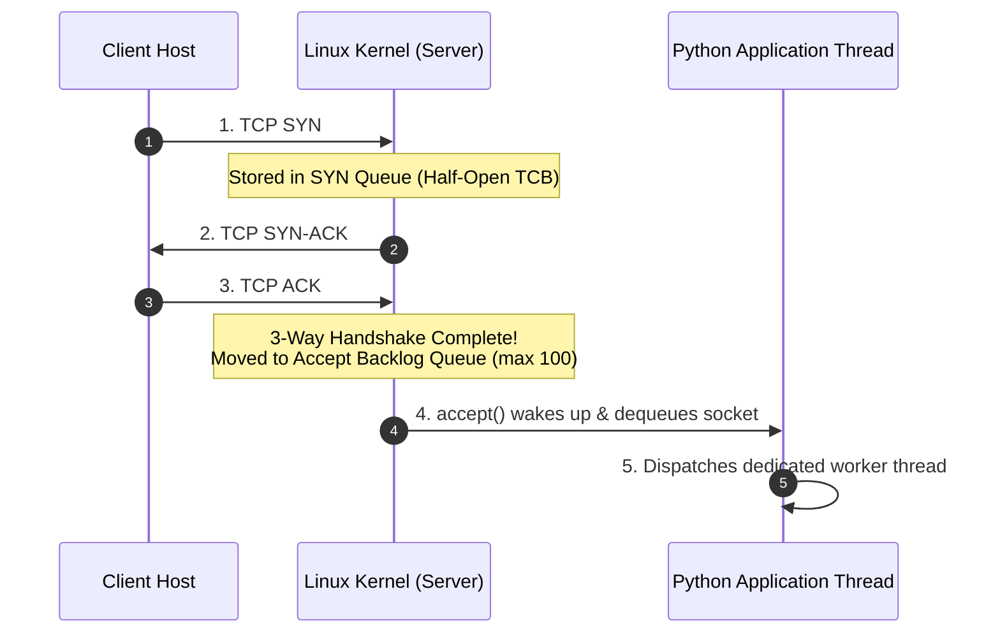

# Data Plane & Low-Level BSD Socket Implementation

AegisFlow implements its protected server (`server.py`) and benchmark client (`client.py`) using **raw Python BSD Sockets** rather than high-level web frameworks like Flask, FastAPI, or Django.

---

## Why Low-Level BSD Sockets Over Web Frameworks?

In production security evaluations, web frameworks introduce heavy layers of abstraction (WSGI/ASGI middleware, HTTP routing tables, request parsing buffers) that mask what is actually happening at the transport layer:

```
[Web Framework (Flask / FastAPI)]
       │
       ▼  WSGI / ASGI Middleware Serialization Overhead
[Python Socket Layer]
       │
       ▼  C-Level POSIX System Calls (libc)
[Linux OS Kernel Network Stack]
       │
       ▼  Device Driver & Ring Buffers
[Network Interface Card (NIC)]
```

By working directly with Python's built-in `socket` library, AegisFlow gains three decisive advantages:

1. **Zero Framework Overhead:** Bypasses request serialization, allowing the server to handle and measure raw wire-speed packet transactions at true line rate ($0.44\text{ ms}$ round-trip time).
2. **Direct Transport-Layer Visibility:** Exposes kernel-level socket queue behaviors, socket options (`SO_REUSEADDR`), and connection lifecycle events.
3. **Accurate Hardware Benchmarking:** Prevents framework garbage collection and middleware delays from distorting RTT latency and queue saturation measurements.

---

## The Protected TCP Server (`server.py`)

Here is the exact socket setup used by the server on Host `h3` (`10.0.0.3`):

```python
import socket
import threading

server_socket = socket.socket(socket.AF_INET, socket.SOCK_STREAM)
server_socket.setsockopt(socket.SOL_SOCKET, socket.SO_REUSEADDR, 1)
server_socket.bind(('0.0.0.0', 8080))
server_socket.listen(100)
```

### 1. `socket.AF_INET` and `socket.SOCK_STREAM`
* `AF_INET` designates the **IPv4** addressing family (`10.0.0.3`).
* `SOCK_STREAM` selects the **Transmission Control Protocol (TCP)**, establishing a reliable, connection-oriented, full-duplex byte stream governed by the TCP 3-way handshake (`SYN`, `SYN-ACK`, `ACK`).

### 2. Eliminating OS `TIME_WAIT` Locks with `SO_REUSEADDR`
When a TCP server shuts down or restarts, the operating system kernel places the local port in a **`TIME_WAIT` state** for $2 \times \text{MSL}$ (Maximum Segment Lifetime, typically 60 to 120 seconds). This state prevents delayed packets from an old connection from corrupting a new connection on the same port.

* **Without `SO_REUSEADDR`:** Restarting the server results in an immediate crash:  
  `OSError: [Errno 98] Address already in use`.
* **With `SO_REUSEADDR` (`setsockopt(SOL_SOCKET, SO_REUSEADDR, 1)`):** The kernel allows the socket to rebind to port `8080` immediately, ensuring instant service recovery without waiting for kernel timeouts.

---

## The OS Kernel Listen Backlog Queue (`listen(100)`)

The parameter `100` in `server_socket.listen(100)` is the **backlog limit**. Inside the Linux kernel network subsystem, there are two distinct queues involved:



### Queue Saturation Under Attack (Without SDN Defense)
When an attacker sends high-rate connection bursts:
1. Connections fill the **Accept Backlog Queue** faster than the Python `accept()` loop can dequeue them.
2. Once the queue reaches **100/100 capacity**, the OS kernel simply drops new incoming `SYN` packets from the network wire.
3. Legitimate clients attempting to connect encounter total connection timeouts (`Connection timed out` or `Connection refused`).

### The SDN Immunity Advantage
Because AegisFlow injects the **Priority 200 DROP** rule on Open vSwitch, the switch discards attacker frames **before they cross the server's wire**. As a result:
$$\text{Attacker Packets Reaching Server Kernel} = \mathbf{0}$$
The kernel accept queue remains completely available for legitimate traffic!

---

## POSIX Multi-Threaded Concurrency

To ensure that serving one client does not block subsequent clients, `server.py` implements a non-blocking `accept()` loop backed by Python's `threading` daemon pool:

```python
def accept_loop():
    while running:
        try:
            conn, addr = server_socket.accept()
            # Immediately spawn an isolated daemon thread for this client
            t = threading.Thread(target=handle_client, args=(conn, addr), daemon=True)
            t.start()
        except Exception:
            break

def handle_client(conn, addr):
    try:
        data = conn.recv(1024)
        if data:
            response = b"HTTP/1.1 200 OK\r\nContent-Type: text/plain\r\n\r\nProtected Service OK\n"
            conn.sendall(response)
    finally:
        conn.close()
```

* **`daemon=True`:** Ensures that when the main server process shuts down, all active worker threads terminate immediately without leaving zombie processes.

---

## Client-Side RTT Telemetry (`client.py`)

The benchmark client on Host `h1` (`10.0.0.1`) issues periodic HTTP requests and measures true application-layer Round-Trip Time (RTT):

```python
t_start = time.perf_counter()
sock = socket.socket(socket.AF_INET, socket.SOCK_STREAM)
sock.settimeout(1.0)
sock.connect((SERVER_IP, SERVER_PORT))
sock.sendall(b"GET /data HTTP/1.1\r\nHost: 10.0.0.3\r\n\r\n")
response = sock.recv(1024)
sock.close()
rtt_ms = (time.perf_counter() - t_start) * 1000.0
```

* **Baseline Performance:** Over local Mininet virtual ethernet pairs (`veth`), clean RTT averages **$0.44\text{ ms}$**.
* **Under Unshielded Attack:** Backlog contention spikes RTT to **$> 18.50\text{ ms}$** with frequent packet drops.
* **Under AegisFlow SDN Defense:** Edge switch filtering restores RTT to **$0.44\text{ ms}$** with 100% packet delivery.
